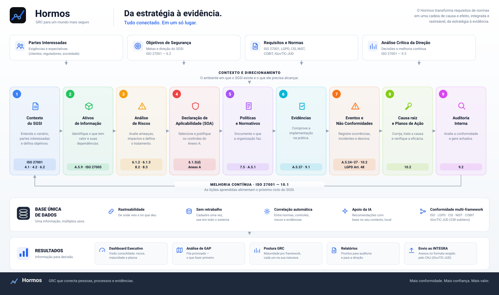

# Hormos — Appliance

Plataforma de GRC auto-hospedada: ISO 27001, LGPD, CIS Controls v8, NIST CSF,
COBIT 2019, ISO 42001 e **iGovTIC-JUD (CNJ)**, com correlação entre normas e
IA local.

> **ὅρμος** (*hórmos*), do grego: o ancoradouro abrigado onde o navio para no
> meio da viagem — e também o colar, contas presas num mesmo fio. Os dois
> sentidos descrevem o produto. Ninguém certifica — **nem se mantém
> certificado** — da noite para o dia: a conformidade não é um destino que se
> alcança e encerra, é uma travessia que continua depois do certificado. O
> Hormos é a parada segura ao longo dela, com ativo, risco, controle,
> evidência e plano num fio só. O símbolo é esse fio, com duas contas.


<p align="center">
  
</p>

O diagrama acima é gerado por `scripts/gerar-infografico.py` — os números saem
do catálogo, não são digitados: diagrama que afirma "238 subitens" não pode
envelhecer em silêncio quando o ciclo mudar.

**Este é o repositório público**: compose, gateway, autenticação, esquema de
banco, instaladores e documentação. O código do portal e o licenciador vivem em
repositórios próprios e privados.

| repositório | conteúdo | visibilidade |
|---|---|---|
| `hormos` (este) | appliance, instaladores, documentação | público |
| `hormos-portal` | código do portal — vira a imagem distribuída | privado |
| `hormos-licenciador` | emissão de licenças, chave privada Ed25519 | privado |

## Requisitos

| | mínimo | recomendado |
|---|---|---|
| **Sistema** | Linux, macOS ou Windows 10/11 | — |
| **Docker** | Engine 24+ e Compose v2 | — |
| **RAM livre** | **2 GB** (stack sem IA) | 8 GB+ (com o LLM completo) |
| **Disco** | **4 GB** | 16 GB (com IA) |
| **Portas** | 443 (e 80 só com domínio próprio) | — |
| **Internet** | só para baixar as imagens na 1ª vez | — |

Medido nesta instalação, não estimado: o stack sem IA ocupa **~1 GB de RAM**
(Keycloak é o maior, 660 MB; o portal, 138 MB) e **~1,8 GB de imagens**.

**Windows não precisa de Docker Desktop.** O `install.bat` instala WSL2 e o
Docker Engine dentro dele — assim o licenciamento do Desktop (pago acima de
250 funcionários ou US$ 10 mi de receita) não se aplica.

O **Analista IA é opcional** e escolhe o modelo pela RAM disponível ao Docker:

| RAM no Docker | LLM local | acrescenta ao disco |
|---|---|---|
| < 6 GB | qwen2.5:1.5b | ~8 GB |
| 6–8 GB | qwen2.5:3b | ~9 GB |
| ≥ 8 GB | qwen2.5:7b | ~12 GB |

Sem o LLM o produto funciona inteiro: o **motor semântico** (embeddings
locais, ~300 MB) roda em qualquer tier e é ele que faz a correlação. O LLM
só refina a redação dos pareceres — os fatos vêm sempre do motor.

**Nada sai da sua rede em nenhum tier.**

## Instalação (cliente)

```bash
./install.sh          # Linux/macOS
install.bat           # Windows (instala WSL2 + Docker Engine)
```

O compose puxa a **imagem publicada e assinada** — não constrói a partir do
código-fonte.

## Desenvolvimento

Clone o repositório do portal ao lado deste e use o override:

```bash
git clone <privado>/hormos-portal ../hormos-portal
docker compose -f docker-compose.yml -f docker-compose.dev.yml up -d --build
```

## Licenciamento

Source-available sob **Elastic License 2.0** (`LICENSE`), com EULA para uso
comercial (`EULA.md`) e avisos de terceiros em `NOTICE`. Não é software livre:
fornecer como serviço gerenciado e contornar a chave de licença são vedados.

---

# Hormos v2.2.0

**Plataforma de Governança, Riscos e Conformidade** — Multi-framework, self-hosted, sem licenciamento por usuário.

## Frameworks pré-carregados

| Framework | Versão | Controles |
|-----------|--------|-----------|
| ISO/IEC 27001 | 2022 | 93 controles Anexo A |
| CIS Controls | v8 | 153 salvaguardas (IG1/IG2/IG3) |
| NIST CSF | 2.0 | 107 subcategorias (6 funções) |
| COBIT 2019 | 2019 | 41 objetivos (5 domínios) |
| ISO/IEC 42001 | 2023 | 38 controles de IA |
| LGPD | 2018 | 20 artigos-chave |
| iGovTIC-JUD | ciclo 2026 | 238 subitens · 28 perguntas de TIC + 10 de negócio |

**Total: 690+ controles pré-carregados + 20 mapeamentos cruzados**

### iGovTIC-JUD — o índice que o CNJ cobra do Judiciário

Não é "mais um framework", e por isso tem tela própria. A régua é outra: a
nota de cada subitem muda **por ano e por segmento** (TRT, TRE, Superiores,
CNJ), e a evidência é julgada item a item — um subitem declarado sem prova
**zera o item inteiro**. O Hormos cobre o ciclo completo:

- **De onde você vem** — o resultado publicado do seu tribunal acompanha a
  instalação (registro público do CNJ, 92 órgãos). Escolha a sigla e veja o
  índice, o nível e quanto faltou em cada pergunta. Sem digitar nada e sem o
  appliance falar com a internet.
- **Ler o ciclo publicado** — a nota de cada pergunta restringe quais subitens
  foram marcados: em ~44% delas a combinação é única, e o Hormos a reconstrói.
  Onde o questionário mudou entre ciclos, ele diz que não é comparável em vez
  de fingir que é.
- **O que o seu SGSI já sustenta** — crosswalk curado com a ISO 27001: se o
  controle está implementado e tem evidência na janela, o subitem é seguro de
  declarar. Se não tem prova, vira aviso, não sugestão.
- **Dossiê para o INTEGRA** — um anexo por item de conformidade, com capa
  gerada, PDF pesquisável, trecho destacado e pré-voo com as regras que o CNJ
  aplicaria.

## Funcionalidades

- **Índice de Segurança Aplicada (ISA)**: o Mapa de Aplicabilidade (Anexo A = ISO/IEC 27002) é o hub —
  correlaciona políticas vinculadas, avaliações ISO 27001 e dos frameworks mapeados (CIS, NIST…)
  em um score 0–100 por controle, por domínio e global (implementação 40% · conformidade 20% ·
  maturidade correlacionada 30% · política vigente 10%)
- **SOA em duas camadas**: seção de **Requisitos do SGSI** (cláusulas 4–10 da ISO 27001, mandatórios —
  prontidão %, status, conformidade, políticas e evidências por requisito) separada dos **93 controles
  do Anexo A** (ISO 27002, com aplicabilidade declarável), com painel de status por framework
  correlacionado (CIS, NIST…) e filtros por status/conformidade/aplicabilidade/política/framework
  (a antiga tela "Mapeamento Cruzado" foi absorvida por esta visão)
- **Evidências por arquivo ou link**: todo ponto de anexo (SOA, avaliações de frameworks, planos,
  NCs e políticas) aceita também um link externo — SharePoint, Google Workspace, GED, repositórios
- **Dashboard Executivo**: maturidade global, heatmap de controles, domínios atual×meta, tendência
- **Framework Engine**: avaliação de maturidade 0-5 (CMMI) em lote, com N/A e evidência por controle
- **Análise de GAP consolidada**: multi-framework, priorizada por criticidade, com criação de plano em 1 clique (GAP→Plano)
- **Planos de Ação**: progresso %, detecção automática de atraso, KPIs por status
- **Gestão de Riscos 5×5**: matriz probabilidade×impacto (Baixo/Médio/Alto/Crítico ≥16), riscos↔controles
- **Cronograma de Auditorias**: auditorias internas (cláusula 9.2), externas (certificação/manutenção)
  e personalizadas, ano a ano — cada auditoria consolida achados (NC Maior/Menor, Observação,
  Oportunidade de Melhoria, Ponto Forte), carta comentário do auditor (texto, arquivo ou link)
  e os registros do SGSI originados nela: NCs, riscos e planos são vinculados à auditoria de origem
  nos próprios formulários; achados do tipo NC convertem-se em NC formal com 1 clique; ao concluir,
  gera o **Relatório de Auditoria (Plano de Ação)** print-friendly para envio aos auditores
- **Relatórios**: 6 relatórios print-friendly (PDF pelo navegador) + exportação CSV
- **Evolução Temporal**: snapshots diários de maturidade por framework
- **SGSI ISO 27001**: Ativos, Riscos, NCs, Planos, SOA, Políticas
- **Saneador Inteligente**: wizard transacional Ativo→Risco→NC→Plano
- **RBAC**: perfis Administrador / Gestor de Risco / Avaliador / Auditor / Leitor (login via Keycloak SSO)
- **Logs de Auditoria**: rastreabilidade completa de todas as ações
- **Design Dark Premium**: fusão GRC Platform + SGSI Appliance

## Temas (escuro premium ⇄ claro enterprise)

O botão 🌓 no topo alterna entre o tema escuro (padrão, premium) e o claro (enterprise),
com persistência por navegador. A tela de login do Keycloak usa o tema `hormos`
(mesma identidade visual), definido em `keycloak/themes/hormos`.

**Tipografia**: Poppins (títulos), Inter (texto) e IBM Plex Mono (códigos/números) —
**auto-hospedadas** na imagem do portal e no tema do Keycloak: nenhuma chamada
a CDN, o visual é idêntico mesmo em appliance 100% offline.

## SSO, MFA e identidade (Keycloak)

O console administrativo fica em **http://localhost:8086/admin** (usuário/senha:
`KEYCLOAK_ADMIN` / `KEYCLOAK_ADMIN_PASSWORD` do `.env`). O portal (módulo Usuários)
tem um guia com atalhos; os principais caminhos no realm `sgsi`:

| Recurso | Onde configurar |
|---|---|
| MFA / OTP (Google Authenticator) | Authentication → Required actions → *Configure OTP* como Default |
| SSO corporativo (Azure AD, Google, SAML/OIDC) | Identity providers → Add provider |
| Federação LDAP / Active Directory | User federation → Add LDAP provider |
| Política de senhas | Authentication → Policies → Password policy |
| Força bruta | Realm settings → Security defenses |
| Sessões / timeout | Realm settings → Sessions |

### Como o SSO aparece no login

O acesso ao portal pula direto para a tela de login do Hormos (tema `hormos`,
sem tela intersticial). Quando você adiciona um Identity Provider no realm `sgsi`,
o botão **"Entrar com ..."** (Azure AD, Google etc.) aparece automaticamente
**nessa mesma tela**, abaixo do usuário/senha — o usuário escolhe como entrar.

Para pular também o usuário/senha e ir **direto ao IdP corporativo** (SSO total):
Authentication → flow **browser** → no passo *Identity Provider Redirector* →
⚙ config → **Default Identity Provider** = alias do IdP (ex.: `azure-ad`).
O login local continua acessível em caso de contingência via
`http://localhost:8086/realms/sgsi/account`.

## Analista IA embarcado (offline)

O instalador detecta a RAM disponível ao Docker e escolhe o **tier** do LLM
(tudo local, nada sai do cliente — grave `OLLAMA_MODEL` no `.env` para forçar):

| RAM no Docker | LLM |
|---|---|
| < 6 GB | qwen2.5:1.5b |
| 6–8 GB | qwen2.5:3b |
| ≥ 8 GB | qwen2.5:7b |

A correlação semântica usa **embeddings locais** (`nomic-embed-text`, ~300MB, todos
os tiers) com TF-IDF como fallback determinístico.

**Não há modelo de visão.** Evidência em imagem sem texto legível (catraca, portão,
sala-cofre) é correlacionada pela **descrição que o usuário informa** — determinístico,
instantâneo e sem custo de RAM. O modelo de visão foi testado e removido: somava
3–5 GB ao lado do LLM, levava minutos a frio e entregava descrição genérica, de baixo
valor probatório. Trade ruim para appliance vendido a cliente com hardware modesto.

Dois estágios, sem nenhuma API externa:

1. **Motor semântico** (sempre ativo, zero recursos extras): analisa o texto das políticas
   anexadas (PDF/DOCX/TXT) e as correlaciona com os controles do Anexo A por TF-IDF + léxico
   PT de SI. Gera: cobertura documental por controle, **GAP Documental** na Análise de GAP,
   sugestão de vínculos política⇄SOA em 1 clique, pareceres em Riscos e NCs e sugestões de
   melhoria em Planos.
2. **LLM local opcional** (refina a redação dos pareceres; fatos vêm sempre do motor semântico):
   ```bash
   ./install.sh local --ia    # sobe tudo + baixa o modelo automaticamente (1 comando)
   ```
   Ou manualmente:
   ```bash
   docker compose --profile ia up -d
   docker compose exec ollama ollama pull qwen2.5:1.5b   # ~1GB, roda em CPU
   ```
   Sem o serviço, tudo funciona com os textos determinísticos (degradação graciosa).
   Modelo configurável via `OLLAMA_MODEL` no `.env`.

   Observações de rede: a `sgsi_internal` é isolada — o serviço `ollama` também entra na
   `sgsi_public` **somente** para o `pull` do modelo; a inferência em si é 100% local.
   Para clientes sem internet, leve o modelo no pacote: na sua máquina, após o pull,
   exporte o volume (`docker run --rm -v sgsi-appliance-core_ollama_data:/d -v $PWD:/out
   alpine tar czf /out/ollama_data.tgz -C /d .`) e restaure no cliente com o comando
   inverso antes do `--profile ia up`.

## Licenciamento (offline, plug and play)

| Edição | Frameworks | Analista IA · GAP · relatórios |
|--------|-----------|-------------------------------|
| **Comunidade** (padrão, sem chave) | ISO 27001/27002 — Anexo A + requisitos das cláusulas 4 a 10 | — |
| **Essencial** | Comunidade + LGPD + CIS Controls v8 | ✔ |
| **Avançado** | Todos (inclui NIST CSF, COBIT e ISO 42001) | ✔ |

A Edição Comunidade é **gratuita e sem prazo**: registra o SGSI por completo em
ISO 27001 — ativos, riscos, controles, políticas, evidências, não conformidades e
planos. O que a licença habilita é a **inteligência sobre esse SGSI** (o Analista
IA, a análise de GAP, os relatórios executivos e a exportação) e os **demais
frameworks**, a começar pela LGPD.

- A chave é assinada em **Ed25519** e validada **100% offline** — nada sai do cliente.
- Aplicar: portal → ⚙ Configurações → **Licença** → colar a chave.
- **A emissão não acontece aqui.** O appliance apenas *verifica*: carrega somente
  a chave pública (`LICENSE_PUBLIC_KEY` no `.env`). A privada vive no licenciador
  do fornecedor, em repositório separado — por isso quem instala o produto não
  consegue emitir a própria licença.
- Frameworks fora do plano aparecem **escurecidos com 🔒** e são bloqueados nas rotas.
- O admin também pode **ativar/desativar** qualquer framework do plano (card fica ⏸ escurecido para os demais usuários).

## Atualização entre versões (v2.x)

Em base existente, reaplique a migração (idempotente — pode rodar quantas vezes quiser):

```bash
docker exec -i sgsi_postgres psql -U $POSTGRES_USER -d $POSTGRES_DB < postgres/04_upgrade.sql
```

Instalações novas já aplicam tudo automaticamente. A migração cobre: escala de risco 3×3 → 5×5,
requisitos ISO 27001 (cláusulas 4–10) no SOA, anexos por link externo e o módulo de Auditorias
(tabelas `auditorias`/`auditoria_achados` + vínculo `auditoria_id` em NCs, riscos e planos).

## Stack

- Flask + PostgreSQL + Caddy + Keycloak + OAuth2 Proxy (Docker)
- LGPD-compliant: dados 100% on-premises

## Instalação

### Linux (Ubuntu/Debian) e macOS

```bash
./install.sh
```

Sem parâmetros, a **instalação é guiada**: o instalador pergunta se o ambiente é
**local ou produção com domínio do cliente** (e já pede domínio/e-mail do certificado),
se quer o **Analista IA** (LLM local) e se é reinstalação do zero. Para automação/CI,
os parâmetros continuam valendo:

```bash
./install.sh local            # instalação local sem perguntas
./install.sh local --ia      # + Analista IA (LLM local, baixa ~1GB)
./install.sh local --reset   # reinstala do zero (APAGA o banco)
```

Pré-requisitos (o instalador verifica e orienta): Docker em execução
(Engine no Linux, Desktop no macOS), Docker Compose (plugin v2 ou
`docker-compose` legado — ambos suportados), `python3` e `openssl`.
No Ubuntu: `sudo apt-get install -y docker.io docker-compose-v2 python3 openssl`
e adicione-se ao grupo (`sudo usermod -aG docker $USER`, relogue).

### Windows (Docker Desktop)

1. Instale o [Docker Desktop](https://www.docker.com/products/docker-desktop/) e abra-o (aguarde ficar verde).
2. **Dê 2 cliques no `install.bat`** na pasta do projeto — ele pergunta se quer
   o Analista IA e se é reinstalação, e faz todo o resto (senhas, realm, subida).
3. Não precisa de Python, OpenSSL nem WSL manual: o instalador usa só PowerShell + Docker.

Por linha de comando (opcional): `powershell -ExecutionPolicy Bypass -File install.ps1 -IA -Reset`.

**Acesso (todos os sistemas):**
- Portal: http://localhost:8080
- Keycloak: http://localhost:8086
- Credenciais: exibidas ao final do instalador (e guardadas no `.env`)

### Produção com o domínio do cliente (HTTPS automático)

Depois do `install.sh`, um único comando coloca o appliance no domínio do cliente,
com certificado **Let's Encrypt emitido e renovado automaticamente** pelo Caddy:

```bash
./configurar-dominio.sh grc.cliente.com.br
# ou, personalizando o domínio de login e o e-mail do certificado:
./configurar-dominio.sh grc.cliente.com.br auth.grc.cliente.com.br ti@cliente.com.br
```

O assistente faz tudo: ajusta as URLs públicas no `.env` (com cookie seguro),
gera o `caddy/Caddyfile` de produção (portal + Keycloak em HTTPS, HSTS),
expõe as portas 80/443 via `docker-compose.override.yml`, re-renderiza o realm
e **atualiza as redirect URIs do client no Keycloak vivo** via kcadm.

Pré-requisitos no cliente: **2 registros DNS** (`grc.cliente.com.br` e
`auth.grc.cliente.com.br`) apontando para o servidor e **portas 80/443
abertas** para a internet. É idempotente — rode de novo para trocar de domínio;
os acessos locais `:8080`/`:8086` continuam ativos para contingência.

## Atualização do v1.x

O v2.0 é um projeto separado. Para migrar dados do v1.x, exporte
os dados (`pg_dump sgsi`) e importe manualmente nas tabelas compatíveis
(ativos, riscos, ncs, planos, soa, politicas).
